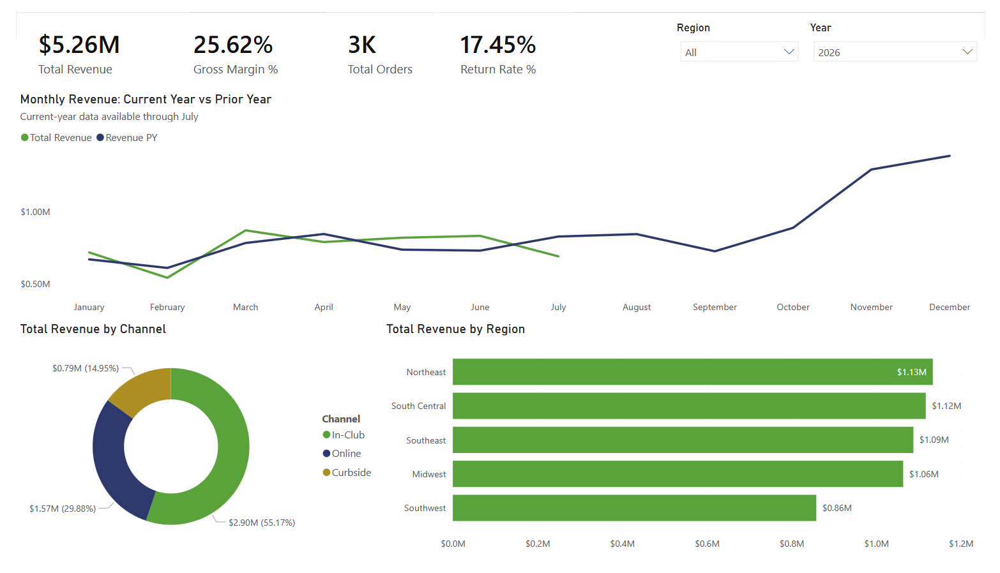
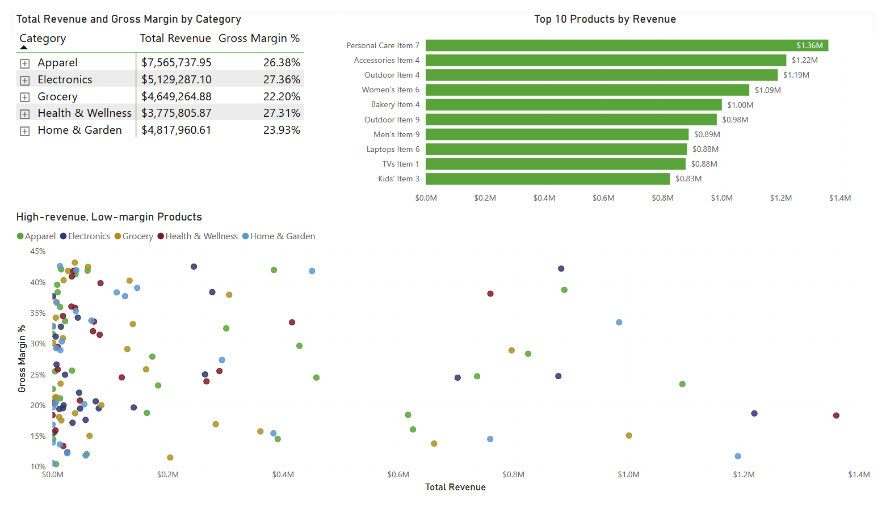
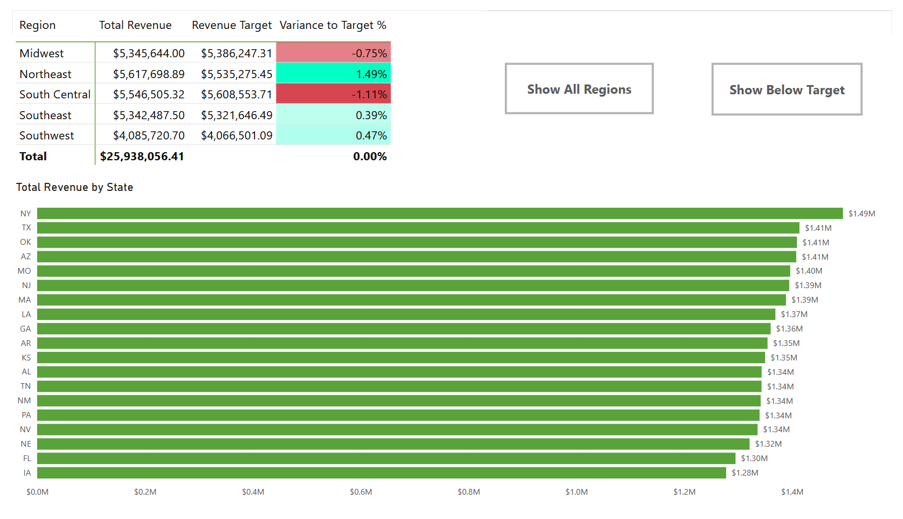
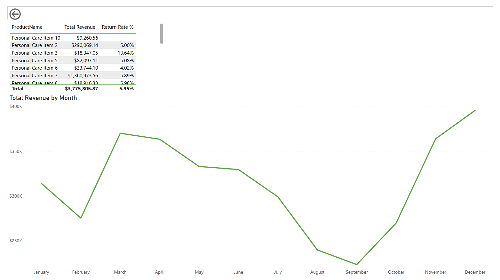

# Power BI Sales Performance Dashboard

An interactive retail reporting project for exploring sales, profitability, returns, and performance against revenue targets. Built with Power Query, a star-schema data model, and DAX.

[View the interactive report](https://app.powerbi.com/view?r=eyJrIjoiZWNhZmQwMDUtMmVkYy00MjAwLWFjYjYtZWFjZjYzZjZjMTZlIiwidCI6IjBjOTg0ZjRmLWQwN2MtNDA3Zi1hNGQ3LWRiZGE1ZDJjYTMxZiJ9&pageName=49852ab876de720ce76c) | [View or download the Power BI file](Sales%20Performance%20Dashboard.pbix)

> Portfolio project using synthetic retail data. No real employer, company, customer, or transaction data is included. Findings are illustrative, not evidence of real business impact.

## Business questions

- How are revenue, gross margin, orders, and returns performing?
- Which products and categories contribute to sales and profitability?
- How does regional revenue compare with targets?
- Where should a manager investigate performance in more detail?

## Dashboard views

### Executive summary

Start here to review the headline sales and profitability metrics before exploring individual products or regions.

### Product performance

Compare product performance to investigate how sales and profitability vary across the product portfolio.

### Regional performance

Explore regional results and revenue performance against targets to identify areas for follow-up.

### Product detail

Use the product-level detail view to investigate a selected product beyond the summary pages.

## How to explore the report

1. Open the interactive report and start with the executive summary.
2. Use the available filters to narrow the analysis. Interpret the displayed metrics within the selected filter context.
3. Navigate to the product or regional views to investigate a result.
4. Use product-level drill-through where available to explore an individual product.
5. Clear selections or return filters to their original settings before making a different comparison.

The screenshots provide static previews; use the interactive report or the downloadable Power BI file to explore filtering and navigation.

## What the project demonstrates

| Area | Work included |
|---|---|
| Data preparation | Power Query cleaning, transformation, and shaping |
| Data modeling | Star-schema model with fact and dimension tables |
| Calculations | DAX measures for KPIs, prior-year comparisons, and variance to revenue targets |
| Analysis | Revenue, gross margin, orders, return rate, product, region, and channel views |
| Report interaction | Product-level drill-through and bookmark-based filtering |
| Communication | Executive overview with supporting performance and detail pages |

## Review the implementation

Download `Sales Performance Dashboard.pbix` and open it in Power BI Desktop to inspect the report pages, data model, Power Query transformations, and DAX measures.

The Power BI file contains the implemented measures, relationships, and report configuration.

## Dataset and limitations

- The retail-sales dataset is synthetic and was generated for portfolio and learning purposes.
- Patterns and recommendations from this report should not be generalized to a real retailer without validation against real data.
- Reported values depend on the selected filters and the measure definitions in the Power BI file.
- This repository presents a portfolio report, not a live operational reporting service.

## Repository files

| File | Purpose |
|---|---|
| [Sales Performance Dashboard.pbix](Sales%20Performance%20Dashboard.pbix) | Downloadable Power BI report |
| [executive-summary.png](executive-summary.png) | Executive summary preview |
| [product-performance.png](product-performance.png) | Product performance preview |
| [regional-performance.png](regional-performance.png) | Regional performance preview |
| [product-detail.png](product-detail.png) | Product detail preview |
